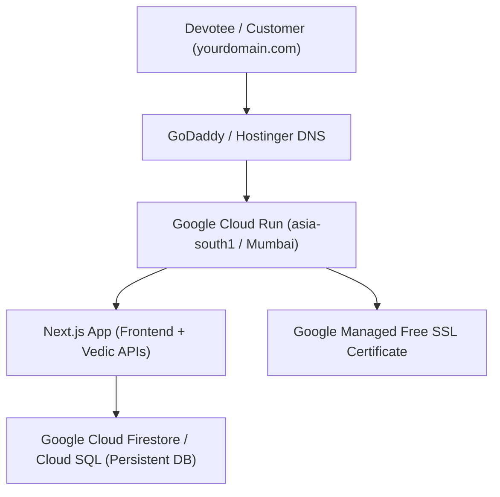

# 🪔 Atmanubhuti – Google Cloud Deployment & Custom Domain Guide

This complete guide explains how to deploy the **Atmanubhuti Vedic Platform** to **Google Cloud (Cloud Run + Database)** and map your **custom domain** (purchased on GoDaddy, Hostinger, or Namecheap) with free automatic SSL.

---

## 🏛️ Architecture Overview



* **Frontend & Backend:** Next.js 16 (Turbopack + Standalone) on **Google Cloud Run**
* **Database:** Google Cloud Firestore (Serverless NoSQL) or Cloud SQL (PostgreSQL)
* **Domain & DNS:** GoDaddy / Hostinger / Namecheap (mapped to Google Anycast IPs)
* **SSL Certificate:** Free automatic 256-bit HTTPS issued and renewed by Google

---

## 📋 Step 1: Install Google Cloud SDK (`gcloud`)

If you don't already have `gcloud` installed on your Mac:

```bash
# Via Homebrew
brew install --cask google-cloud-sdk
```

Then authenticate and login with your Google account:

```bash
gcloud auth login
```

---

## 📋 Step 2: Set your Google Cloud Project

Create or select your project in the [Google Cloud Console](https://console.cloud.google.com):

```bash
# Set your active project ID
gcloud config set project YOUR_PROJECT_ID
```

Enable billing on your project if not already done. (Google Cloud provides $300 free credits for new users, and Cloud Run has 2 million free requests per month!).

---

## 📋 Step 3: Enable Google Cloud Database (Firestore)

1. Open [Google Cloud Console - Firestore](https://console.cloud.google.com/firestore).
2. Click **Create Database**.
3. Select **Native Mode** (Recommended for Web Applications).
4. Choose Location: `asia-south1` (Mumbai) for maximum speed in India.
5. Click **Create**.

---

## 📋 Step 4: Deploy to Google Cloud Run (One-Click)

We have created an automated deployment script for you:

```bash
./deploy-gcp.sh
```

Or run the commands manually:

```bash
# 1. Enable Cloud APIs
gcloud services enable run.googleapis.com cloudbuild.googleapis.com artifactregistry.googleapis.com firestore.googleapis.com

# 2. Build the container on Google Cloud (No local Docker needed!)
gcloud builds submit --tag gcr.io/$(gcloud config get-value project)/atmanubhuti-web:latest

# 3. Deploy to Cloud Run
gcloud run deploy atmanubhuti-web \
  --image gcr.io/$(gcloud config get-value project)/atmanubhuti-web:latest \
  --platform managed \
  --region asia-south1 \
  --allow-unauthenticated \
  --memory 512Mi \
  --cpu 1 \
  --min-instances 0 \
  --max-instances 10
```

Once deployment completes, Google Cloud will provide a live URL (e.g. `https://atmanubhuti-web-xyz.a.run.app`).

---

## 📋 Step 5: Map your Custom Domain (GoDaddy / Hostinger / Namecheap)

### A. Add Domain Mapping in Google Cloud Run:

In terminal:
```bash
gcloud beta run domain-mappings create \
  --service atmanubhuti-web \
  --domain yourdomain.com \
  --region asia-south1
```

*(Replace `yourdomain.com` with your actual domain, e.g. `atmanubhuti.in`).*

Google Cloud will return the exact **DNS Resource Records** you need to add to your registrar.

---

### B. Add DNS Records in GoDaddy / Hostinger / Namecheap:

Login to your domain provider (GoDaddy / Hostinger), go to **DNS Management / DNS Zone**, and add these records:

#### 1. For Root Domain (`yourdomain.com`):
Add **4 A-Records** pointing to Google's Anycast IP addresses:

| Type | Name / Host | Value / Points to | TTL |
| :--- | :--- | :--- | :--- |
| **A** | `@` | `216.239.32.21` | 3600 (1 hour) |
| **A** | `@` | `216.239.34.21` | 3600 (1 hour) |
| **A** | `@` | `216.239.36.21` | 3600 (1 hour) |
| **A** | `@` | `216.239.38.21` | 3600 (1 hour) |

*(Optional: You can also add the 4 `AAAA` IPv6 records provided by Google).*

#### 2. For `www` Subdomain (`www.yourdomain.com`):
| Type | Name / Host | Value / Points to | TTL |
| :--- | :--- | :--- | :--- |
| **CNAME** | `www` | `ghs.googlehosted.com.` | 3600 |

---

## 🔒 Automatic SSL Certificate

Once DNS records are saved:
* Google Cloud automatically detects the DNS propagation.
* Google provisions a **Free Managed SSL Certificate (Let's Encrypt / Google Trust Services)**.
* Your website will automatically be live and secure with HTTPS within 15–30 minutes!

---

## 🪔 Admin Credentials on Production:
* **Admin Login URL:** `https://yourdomain.com/admin/login`
* **Admin Email:** `admin@atmanubhuti.in`
* **Password:** `Atma@1008` (Configurable in Cloud Run Environment variables).
